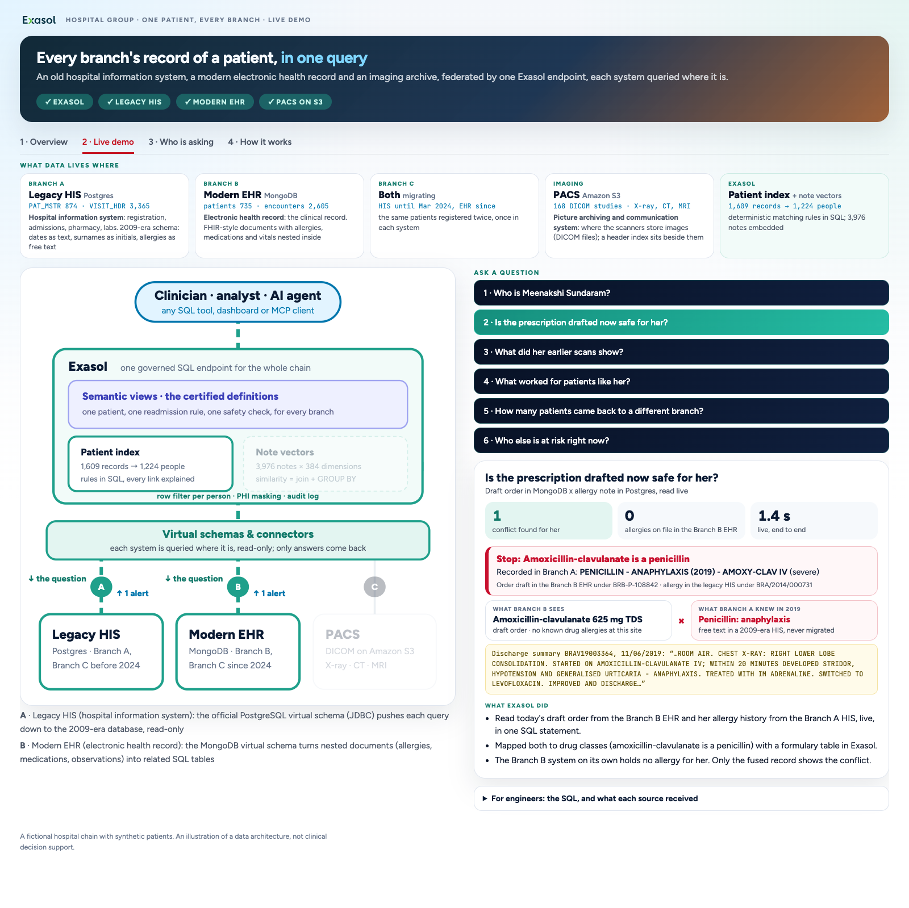
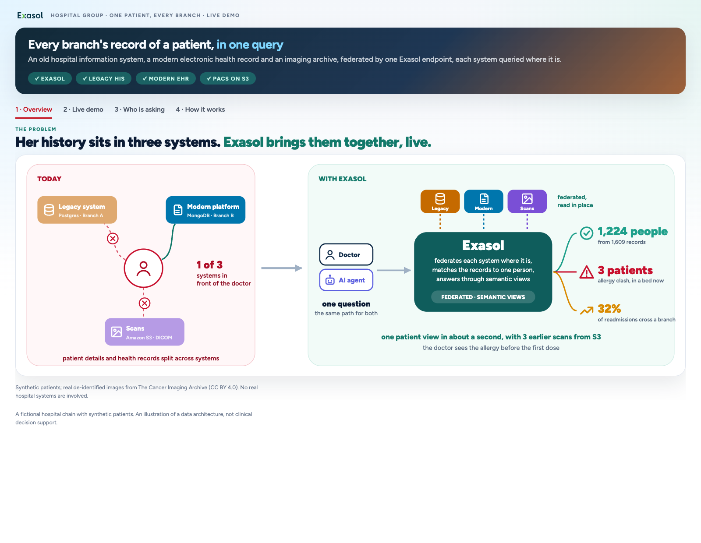
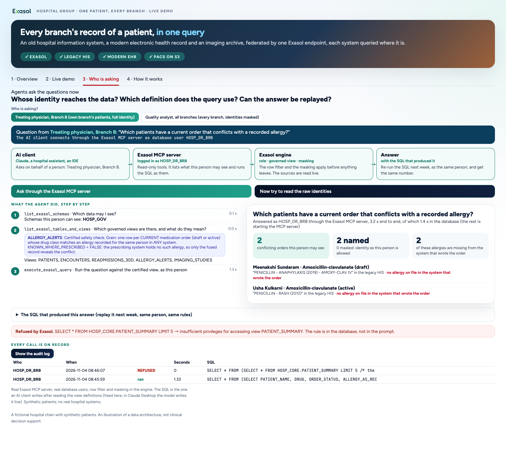

# One patient, every branch: a hospital chain on Exasol

A hospital chain that grew by acquisition runs three systems that share no patient ID: an old hospital information
system on **Postgres**, a modern electronic health record on **MongoDB**, and a DICOM imaging archive on **Amazon S3**.
Exasol reads all three **where they are**, ties the records to one person with a patient index written in SQL,
applies one set of access rules, and answers in one to two seconds. Nothing is migrated. An AI agent (the real
`exasol-mcp-server`) asks the same questions as a named person and gets exactly that person's rows.

The story: Mrs Meenakshi Sundaram, 68, diabetic, had anaphylaxis to amoxicillin-clavulanate at Branch A in 2019. That
fact is free text in the legacy system. Today she is admitted at Branch B, whose health record has no allergy on file,
and the doctor drafts amoxicillin-clavulanate. Neither system can see the conflict. Exasol can.

Everything runs on one laptop (Exasol Personal, the free single-node Exasol database in a local VM, with the two
branch systems in containers inside that VM and a web console on dash-server, a starter-kit add-on that hosts Dash
apps), except the images, which live in **your own S3 bucket**: an AWS account is required ([AWS and cost](#aws-and-cost)).
The hospital chain and its patients are fictional.



## What you see

| Tab | What it shows |
|---|---|
| 1 Overview | today (three systems, three screens, nobody sees the whole patient) against Exasol reading every system in place |
| 2 Live demo | six questions, each run live against the sources, with the systems it touched lit up: **who is she** (one person, four records, two ID schemes) · **is the drafted prescription safe** (draft order in MongoDB × allergy note in Postgres) · **her earlier scans** (DICOM from S3, rendered from the file on request) · **what worked for patients like her** (note vectors) · **who came back to a different branch** (readmissions no single system can count; live, then from Exasol's copy) · **who else is at risk right now** |
| 3 Who is asking | the same question through the Exasol MCP server as a doctor (own branch, full names) and as an analyst (every branch, names masked); the raw table is refused; every call in the audit log |
| 4 How it works | the flow from the three systems through Exasol to the answer, and question 2 taken apart step by step with measured times |

Every answer has a "For engineers" fold-out with the SQL and what each source actually received. A Streamlit version
of the same console runs as a fallback.





## Architecture


| Layer | Schema | What it does | Stored or live |
|---|---|---|---|
| Access | `HOSP_GOV` | five governed views with their definitions in `COMMENT IS`; rows filtered by `CURRENT_USER`, names masked for the analyst | views, live |
| Meaning | `HOSP_CORE` | the patient index, encounters, allergies, orders, the safety check, readmissions, note vectors, imaging | index and vectors stored; the rest views over live data |
| Vocabulary | `HOSP_SRC` | one shape for both systems: text dates parsed, names split, nested documents flattened | views, live |
| Connectors | `HOSP_LEGACY`, `HOSP_EHR_PATIENTS`, `HOSP_EHR_ENCOUNTERS`, connection `HOSP_S3` | the sources, queried where they are, through read-only logins | nothing stored |
| Speed | `HOSP_ACCEL` | a copy of encounters for the readmission question | stored table |

The rule: **everything expensive happens once, a question only reads.** Matching identities and embedding notes are
done ahead of time; a question reads the sources live, joins in Exasol, and returns. Postgres receives ordinary
SELECTs with only the needed columns and filters; MongoDB a `find` with a projection and a filter; S3 one GET for the
index. The images never pass through the database. `docs/tech-spec.html` explains every part in depth.

## Data sources

Everything the demo loads is in this repository, in `data/out/`. Everything is synthetic except the images.

| Source | Technology | Contents | Where it comes from |
|---|---|---|---|
| Legacy HIS (Branch A, and Branch C before April 2024) | Postgres 16, container `hc-legacy-pg` | 874 patient records, 3,365 visits, 507 allergy notes in free text, 2,234 discharge summaries, lab results, prescriptions: a 2009-era schema with dates as text | generated, seeded (`data/generate.py`); the tables as CSV in `data/out/sources/legacy_his/` |
| Modern EHR (Branch B, and Branch C since April 2024) | MongoDB 8.2, container `hc-modern-mongo` | 735 patients and 2,605 encounters as FHIR-style documents with allergies, conditions, medications and observations nested inside; 47 patients in a bed now | generated, seeded (`data/generate.py`); the collections as JSON Lines in `data/out/sources/modern_ehr/` |
| Imaging archive | Amazon S3, your bucket | 168 DICOM studies (chest X-ray, chest CT, brain MRI, 139 MB), a preview each, and the header index | real de-identified images from The Cancer Imaging Archive (COVID-19-AR, UPENN-GBM; CC BY 4.0), relabelled to the synthetic patients; in `data/out/dicom`, `thumbs`, `dicom_index.*`, uploaded by `data/imaging.py upload` |
| Note vectors | Exasol table `HOSP_CORE.NOTE_VECTORS` | 3,976 clinical notes × 384 dimensions (1.5 M rows, long and narrow, so similarity is a join + GROUP BY) | BAAI/bge-small-en-v1.5; shipped as `data/out/note_vectors.parquet`, `data/embed.py --compute` recomputes them |
| Ground truth | `data/out/truth_*.csv` | which record is which person: **never loaded into Exasol**, only used to measure the patient index | the generator |

The generator registers people the way real systems do: surnames as initials, spelling variants, day and month swapped,
two-digit years, age instead of a birth date, landlines instead of mobiles. The patient index has to earn its answer:
1,609 records resolve to 1,224 people with precision 100% and recall 94.3% against the ground truth
(measured by `data/check_mpi.py`; the console shows the measured figure, never a typed-in one).

## Prerequisites

> **Before you clone**, check that you have:
>
> - **A Mac, ideally Apple silicon.** That is the only tested setup. Linux is untested and Windows is not supported.
> - **The Exasol Personal Local Starter Kit** with the database running, plus the **dash-server** add-on.
> - **Docker Desktop (running)**, **uv** and the **AWS CLI v2**.
> - **An AWS account** with an S3 bucket you own and the right to create one IAM user (see [AWS and cost](#aws-and-cost)).
>   There is no AWS-free mode: the imaging archive lives on S3.
> - **About 5 GB of disk and 10 minutes.** The clone is ~100 MB (the data set and 168 images are in the repository).

Tested on **macOS on Apple silicon** with `exakit` 0.2.2, the `exasol` CLI 2.3.0, dash-server 0.1.1 and Exasol Personal
2026.2.0-nano.3 (the engine bug under *Things that will bite* is specific to it). Newer versions are untested. Linux is
untested (the scripts rely on the macOS layout of the Exasol Personal VM); Windows is not supported.

The details:

- **Exasol Personal Local Starter Kit** (`exakit`), with the database running (`exakit status`). It provides the
  `exasol` command-line tool and writes `~/.exapump/config.toml` (profile `starter-kit`, used by the setup scripts).
- **dash-server** add-on for the console: `exakit marketplace dash-server`.
- **Docker Desktop**, running, on the host: to fetch `postgres:16` and `mongo:8.2` (the Exasol VM has no internet access, so
  images are pulled on the host and streamed in) and to build the MongoDB adapter in a Rust container.
- **uv** (`brew install uv`); it installs Python 3.12 for the project if needed. `uvx` (part of uv) runs the MCP server.
- **AWS:** the AWS CLI v2, an S3 bucket you own **in `HC_S3_REGION`** (default `ap-south-1`), and a profile that can
  upload to it and create one IAM user (the read-only reader Exasol and the console use). See [AWS and cost](#aws-and-cost).
- About **5 GB** of free disk space: the clone (~270 MB on disk), the Python environment (~620 MB), Docker images for
  Postgres, MongoDB and the Rust build (~1 GB to download, stored on the host and again in the VM).
- **Optional:** Google Chrome for the browser test.

## AWS and cost

The images live in **your** S3 bucket, so the demo needs an AWS account:

- **Rights for the profile in `HC_AWS_PROFILE`:** `s3:PutObject` on the bucket, and `iam:GetUser`, `iam:CreateUser`,
  `iam:TagUser`, `iam:PutUserPolicy`, `iam:CreateAccessKey` to create the read-only user `hc-s3-reader`. Accounts that
  forbid IAM users can bring their own read-only key instead: put it in `secrets/s3_reader_key.json`
  (the JSON of `aws iam create-access-key`) before the build, and the build skips creating one.
- **What the read-only user may do:** `s3:GetObject` and `s3:ListBucket` on this demo's part of that one bucket
  (`HC_S3_PREFIX`), nothing else. Its access key is long-lived; `setup/uninstall.sh --yes --aws` deletes it.
- **Region:** the bucket must be in `HC_S3_REGION`; the S3 connection is built for that region.
- **Cost:** about 150 MB stored, one upload, and small reads: each question reads the 98 KB index once, an image is
  fetched only when someone opens it, and an open console checks the archive at most every 10 minutes. On standard S3
  pricing that is a few US cents a month. Remove it all with `setup/uninstall.sh --yes --aws`.

## Install

```sh
git clone https://github.com/yuvi-ex/hospital_chain.git
cd hospital_chain
echo "HC_S3_BUCKET=<your-bucket-name>" >> config.local.env   # replace <your-bucket-name>; add HC_AWS_PROFILE=... and
                                                               # HC_S3_REGION=... if yours are not "default" / "ap-south-1"
setup/build_all.sh
```

It takes about 5 minutes (measured). The first run on a new machine takes longer because it downloads a Rust build image and the two database images. Every step
can be re-run; to resume after a failure: `setup/build_all.sh <step>`. At the end it prints **GO** and the console
address, by default http://127.0.0.1:5100/apps/hospital-chain/.

What the installer does, in order:

0. Creates `.venv` from `requirements.txt`.
1. Starts Postgres and MongoDB as podman containers **inside** the Exasol VM (`setup/00_sources_vm.sh`).
2. Installs the JAVA language container if it is missing (this restarts the database); downloads the Rust language
   container, builds the MongoDB virtual-schema adapter in Docker and registers both (`setup/01_mongo_vs.sh`).
3. Generates the hospital chain into both systems, creates their read-only logins, writes `data/out` (`data/generate.py`).
4. Downloads the PostgreSQL virtual-schema adapter and JDBC driver; creates the connections and the three virtual
   schemas (`setup/02_sources.sh`).
5. Loads the note vectors (`data/embed.py`).
6. Builds the typed views and the patient index, and measures it against the ground truth (`sql/10_*`, `sql/20_*`,
   `data/check_mpi.py`).
7. Uploads the images to S3, creates the read-only IAM user (key in `secrets/`, mode 600, git-ignored), checks every
   object, syncs the VM clock, creates the S3 connection and the imaging views.
8. Builds the clinical views, the governed views with their role and two named users (passwords generated into
   `secrets/agent_users.env`, never printed), the accelerated copy and the console's audit view.
9. Deploys the console to dash-server.
10. Runs the preflight check.

## Configuration

`config.env` holds every setting: the S3 bucket, region and key prefix, the AWS profile, container names and ports,
the console name and ports. To change one, put it in `config.local.env` (git-ignored), for example:

```sh
HC_S3_BUCKET=my-bucket
HC_AWS_PROFILE=my-aws-profile
HC_S3_PREFIX=hospital-chain/
```

An environment variable of the same name overrides both. All database objects are prefixed `HOSP_`, the containers
`hc-`, so the project can live next to other work on the same database. Credentials never go in the config files.

## Day to day

Run these from the repository root.

| Task | Command |
|---|---|
| Before a demo: GO / NO-GO, starts what is stopped, fixes the VM clock | `setup/preflight.sh` |
| Start the containers after the VM restarted | `setup/00_sources_vm.sh` (preflight does it) |
| Redeploy the console after a change | `.venv/bin/python dash/deploy.py` |
| The fallback console (optional, Streamlit, loopback only) | `app/run.sh` (http://localhost:8515) |
| Measure the patient index | `.venv/bin/python data/check_mpi.py` |
| Check every image is in the bucket | `.venv/bin/python data/imaging.py verify` |
| Browser test of every tab and question | `.venv/bin/python tools/shoot_dash.py .work/shots over demo:who demo:allergy demo:scans render demo:similar simtext demo:readmit demo:chain agent flow` |
| A self-contained HTML copy of the console for reviewers | `.venv/bin/python tools/export_static.py review.html` |
| Shell inside the Exasol VM | `setup/vm.sh '<command>'` |
| Remove the demo's database objects, containers, console and local secrets | `setup/uninstall.sh --yes` |
| ...and also its S3 objects and the read-only IAM user with its access key | `setup/uninstall.sh --yes --aws` (your bucket itself stays) |
| What uninstall leaves on purpose (shared with other work) | the JAVA and RUST script languages, the MongoDB adapter, the loader's JDBC driver, Docker images, `.venv`, `.work` |

## Repository layout

| Path | What |
|---|---|
| `setup/` | installer (`build_all.sh`), Python environment, sources in the VM, adapters, connections, imaging, governance, preflight, VM clock, uninstall |
| `sql/` | `10` typed views over both systems · `20` the patient index · `25` imaging · `30` clinical rules · `40` governed views · `50` the accelerated copy · `60` the console's audit view |
| `data/` | the generator, embeddings, image archive and index check; `out/` is the whole data set |
| `dash/` | the console (Dash on dash-server) and `deploy.py` |
| `app/` | the Streamlit fallback console |
| `agent/mcp_runner.py` | starts `exasol-mcp-server` as a named user for the "Who is asking" tab |
| `tools/` | headless browser test and the static review export |
| `docs/` | `tech-spec.html` (the full technical specification), the architecture diagram and the screenshots in this README |
| `config.env`, `hcconfig.py` | settings, read by the shell scripts and the Python code |

## Things that will bite

- **"Registry full":** after a burst of Postgres virtual-schema queries, Exasol Personal can run out of ETL channels;
  queries over the legacy system queue for minutes. Restart the database (`exasol stop && exasol start`), then
  `setup/preflight.sh`.
- **After the VM restarts** the containers do not come back by themselves, and **the VM clock drifts** (S3 then refuses
  signed requests with 403). `setup/preflight.sh` fixes both; a resync loop keeps the clock right.
- **Why the sources run inside the VM:** a managed-Mac firewall can block inbound connections to every app, so the VM
  cannot reach Docker-published ports. Containers in the VM's own podman are reached at `10.88.0.1` by Exasol.
- **MongoDB 8.0 / latest will not boot** on recent kernels; the scripts pin `mongo:8.2`.
- **The MongoDB adapter must be a Linux build.** The installer compiles it inside a Rust container; compiling into a
  folder shared with the Mac fails on Docker Desktop with "can't find crate".
- **JDBC driver location:** this Personal build's loader reads drivers from `vm-shared/exa/jdbc/<name>/`, not from
  BucketFS; `setup/02_sources.sh` puts it there.
- **Engine bug (2026.2.0-nano.3):** an aggregate with no group key, or GROUP BY an expression, over a UNION ALL of
  virtual-schema tables aborts the session. All demo SQL groups by a column.
- **Parquet from S3** adds a fixed ~12 s per request on this build, so the imaging view reads the CSV copy of the index.
- **Session cap:** Exasol Personal allows 20 sessions. If the console stops answering with `08004`, restart
  dash-server: `exakit stop dash-server && exakit start dash-server`.

## What is real

Exasol, the virtual schemas over Postgres and MongoDB, the S3 reads, the patient index, the governed views, the named
users, the MCP server and the audit log are real and running. The hospital chain is **fictional**: branches A, B and C
(codes `BRA`, `BRB`, `BRC` in record IDs, `HOSP_DR_BRB` is "a doctor at Branch B") and towns "City A/B/C". The
patients, visits, notes, orders and allergies are synthetic, generated with a fixed seed; phone numbers are in the
undiallable `0000…` range; no real person or hospital is involved. The data is a snapshot as of 2026-10-26.

The medical images are real, de-identified studies from The Cancer Imaging Archive. Every header field was replaced
for the synthetic patient (identity, age, dates, UIDs, institution); private tags and the source subject's size,
weight and ethnicity were removed; the pixels were downsampled.

**Not medical advice.** The safety checks and "patients like her" are illustrations of a data architecture on
synthetic data, not clinical decision support.

## Glossary

| Term | Meaning |
|---|---|
| HIS | hospital information system: registration, admissions, billing (here the 2009-era legacy system on Postgres) |
| EHR | electronic health record: the clinical record (here the modern system on MongoDB) |
| FHIR | HL7's standard JSON shape for health records; the EHR documents follow it loosely |
| DICOM | the file format of medical images; each file carries a header (patient, study, device) and the pixels |
| PACS | the archive that stores DICOM images (here an S3 bucket) |
| PHI | protected health information: anything that identifies a patient together with their health data |
| MPI | master patient index: which records in which systems belong to the same person |
| Readmission | an inpatient admission within 30 days of a discharge |
| Virtual schema | Exasol tables that query a remote system (Postgres, MongoDB) live, without copying |
| Script language container (SLC) | the runtime an Exasol UDF or adapter needs (Java, Rust) |
| BucketFS | Exasol's file store for UDF code, drivers and adapters |
| MCP | Model Context Protocol: how an AI agent calls tools; `exasol-mcp-server` gives it SQL as a named database user |

## Support and contributing

This is a demo, provided as is; it is not clinical software. Questions and bug reports: open an issue at
https://github.com/yuvi-ex/hospital_chain/issues. Pull requests are welcome; see [CONTRIBUTING.md](CONTRIBUTING.md).
To report a security problem privately, see [SECURITY.md](SECURITY.md).

## License

MIT, see [LICENSE](LICENSE).

**Image credits.** The DICOM images in `data/out/dicom` (and their previews) are derived from The Cancer Imaging
Archive (TCIA) and shared under [CC BY 4.0](https://creativecommons.org/licenses/by/4.0/). They were modified:
relabelled to synthetic patients and downsampled. Please cite the collections and TCIA when you reuse them:

- COVID-19-AR collection: https://doi.org/10.7937/tcia.2020.py71-5978
- UPENN-GBM collection: https://doi.org/10.7937/TCIA.709X-DN49
- Clark K. et al., *The Cancer Imaging Archive (TCIA): maintaining and operating a public information repository*,
  Journal of Digital Imaging 26(6), 2013: https://doi.org/10.1007/s10278-013-9622-7

Other third-party material is not redistributed: the embedding model BAAI/bge-small-en-v1.5 (MIT) is downloaded only
by `data/embed.py --compute`; container images and Python packages are pulled by you under their own licenses (MongoDB
Server: SSPL; psycopg: LGPL-3.0). The Exasol name and logo are trademarks of Exasol AG and are not covered by the MIT
license.
